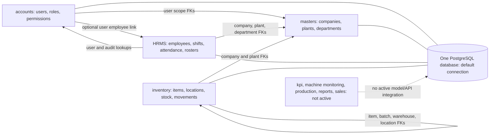
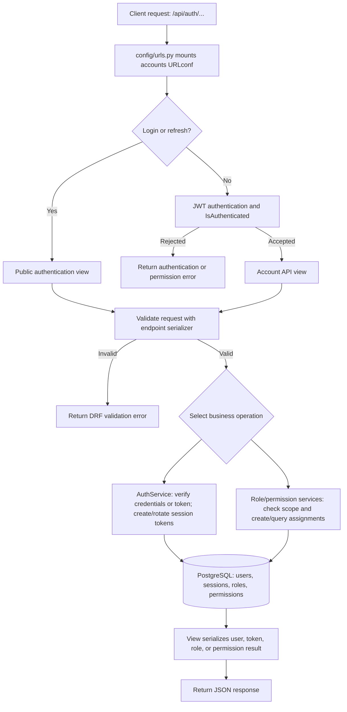
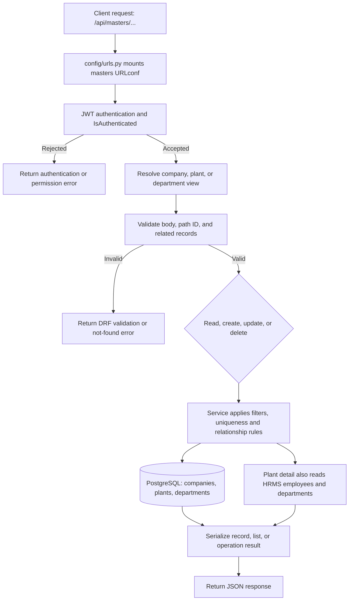
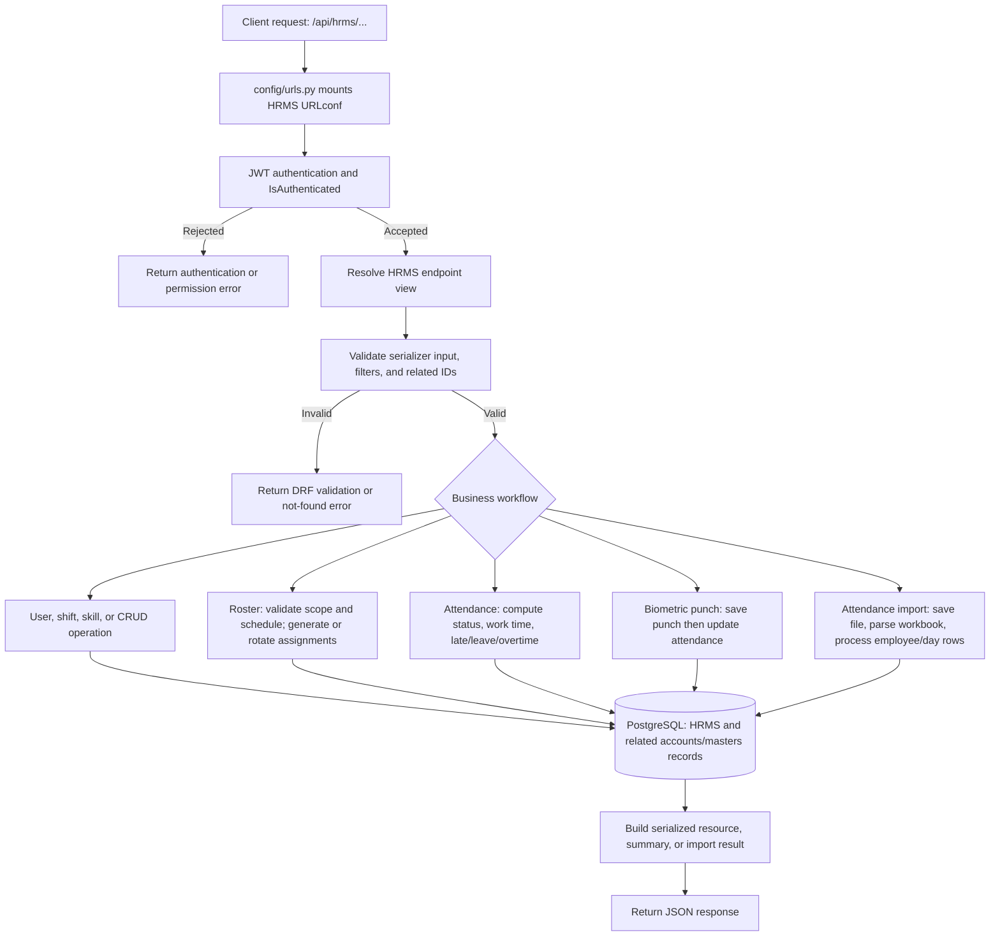
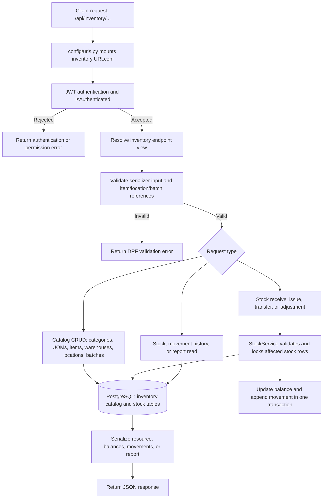
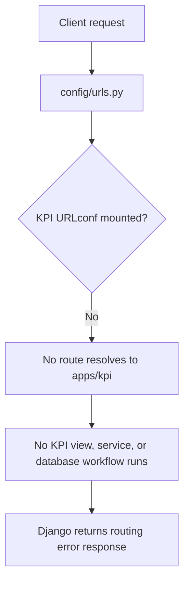
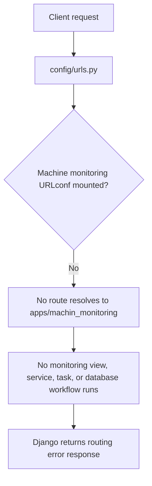
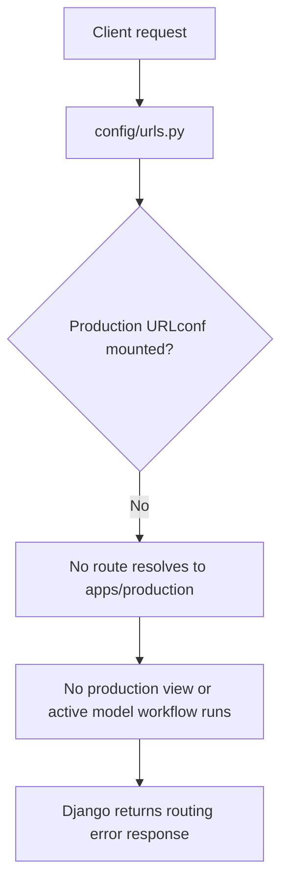
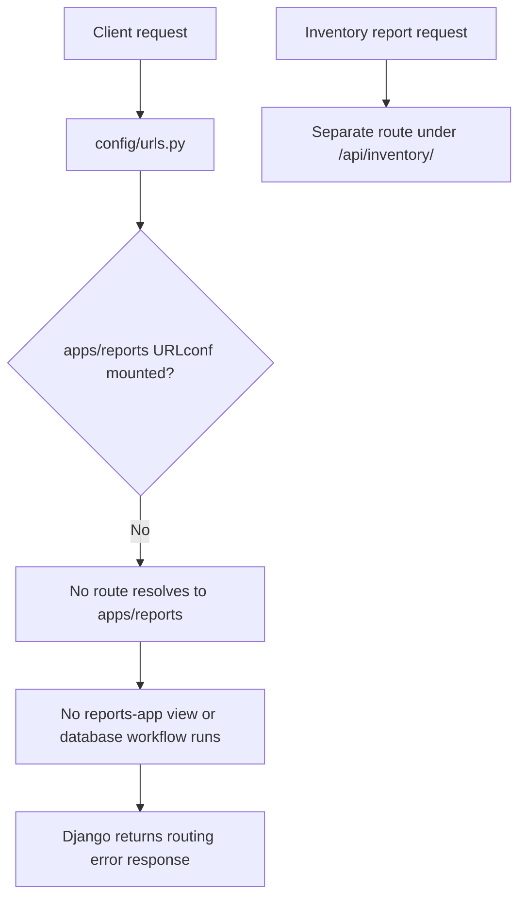
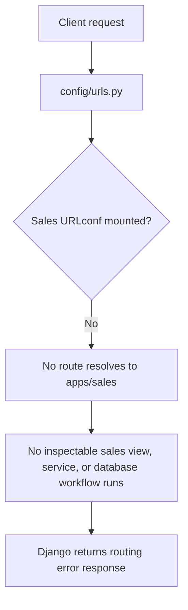

# Application request and data workflows

This document describes the checked-in Django request paths: how a request is routed, where its business logic runs, how data is persisted, and how the response returns. It distinguishes mounted APIs from app folders that currently have no live API route.

## Project-wide request and database flow

1. Django receives the request and routes it through `config/urls.py`.
2. API endpoints are dispatched to Django REST Framework (DRF) views. Unless a view overrides them, `config/settings.py` applies `apps.accounts.authentication.JWTAuthentication` and `IsAuthenticated`.
3. Views parse the request, validate input with serializers, then invoke app services or ORM operations. Model writes and queries use Django's ORM.
4. DRF serializes results and returns a JSON response. Authentication and validation failures are returned through DRF's normal error handling; individual views may wrap successful responses in `success`, `message`, `count`, or `data`.

The default database is PostgreSQL. Connection values (`DB_NAME`, `DB_USER`, `DB_PASSWORD`, `DB_HOST`, and `DB_PORT`) are loaded from environment variables in `config/settings.py`; the database driver is selected there. The Django models and migrations define the schema. Cross-app foreign keys (for example, HRMS employees to masters departments/plants and HRMS users to accounts users) are resolved through the same configured database.

## Database connectivity and inter-app dependencies

### Connection topology

- `config/settings.py` defines one Django database connection named `default`, with the PostgreSQL backend. Credentials and host settings come from `DB_NAME`, `DB_USER`, `DB_PASSWORD`, `DB_HOST`, and `DB_PORT`.
- No `DATABASE_ROUTERS` setting is configured, so ORM queries from the installed apps use this same default connection. These apps are not separate databases or services; they share one database/schema and can join related records through Django ORM foreign keys.
- Migrations create and evolve the tables. ORM foreign keys represent database relationships, subject to the migrations actually being applied to the deployment database.
- The app-level connections below describe the relationships in the checked-in models. A query in a service may also look up another app's model even when there is not a direct foreign key.

### Active app database map

| App | Own records/tables (examples) | Cross-app database dependencies |
|---|---|---|
| `accounts` | `users`, `user_sessions`, `roles`, `permissions`, `user_roles`, `role_permissions`, `user_permissions`, `password_reset_tokens`, `audit_logs` | `User` references masters `Company`, `Plant`, and `Department`, and has a one-to-one optional reference to HRMS `Employee`. `Role` and `Permission` also carry optional company/plant/department scope references. |
| `masters` | `companies`, `plants`, `departments` | Root organization records. `Plant` references `Company`; `Department` references both `Company` and `Plant`. Other apps use these IDs as organizational scope. Plant details additionally query HRMS `Employee` for counts. |
| `hrms` | `employees`, `skills`, `department_skills`, `employee_skills`, `hrms_shifts`, `hrms_employee_shifts`, `rosters`, `roster_assignments`, `hrms_attendance`, `hrms_attendance_logs`, biometric tables, attendance-import tables, and related employee profile/document tables | Employee, shift, roster, attendance, biometric, and import records reference masters company/plant/department. HRMS also references accounts users for user provisioning/assignment and audit fields; the accounts `User` model points back to an HRMS employee. |
| `inventory` | `inventory_categories`, `inventory_uoms`, `inventory_items`, `warehouses`, `storage_locations`, `inventory_batches`, `inventory_stock`, `inventory_stock_movements` | Inventory category/UOM/item/location/stock records reference masters company and plant. Inventory stock and movement tables also reference inventory-owned items, batches, warehouses, and storage locations. No direct accounts or HRMS foreign keys were identified in these inventory models. |
| `kpi`, `machin_monitoring`, `production`, `reports`, `sales` | No active app model/table workflow found in checked-in code | These apps are not installed and are not mounted by the project URLconf. No active ORM or foreign-key dependency is documented for them. |

### Inter-app dependency flow

The arrows show relationships or lookups, not separate database connections or synchronous HTTP calls between apps. For example, HRMS can resolve a plant or user by querying the corresponding Django model on the shared PostgreSQL connection.

## Security mechanisms and important caveats

This section records the mechanisms visible in the current source. It distinguishes hashing, encryption, and token signing; these are different operations and should not be treated as interchangeable.

| Mechanism | Current behavior | Where it is used |
|---|---|---|
| JWT bearer authentication | Custom DRF `JWTAuthentication` extracts a bearer token from the Authorization header, verifies an access token with `JWTService`, then loads an active user. Protected API endpoints require authentication by default; login and refresh are public. | `apps/accounts/authentication.py`, `apps/accounts/services/jwt_service.py`, `config/settings.py` |
| JWT signing: HS256 | Access and refresh tokens are signed with HMAC-SHA-256 using `JWT_SECRET_KEY` (currently assigned from Django `SECRET_KEY`). Tokens include a type and expiration; configured lifetimes are 11 hours for access tokens and 7 days for refresh tokens. HS256 signs tokens—it does not encrypt their contents. | `apps/accounts/services/jwt_service.py`, `config/settings.py` |
| Password hashing | The custom user model inherits Django `AbstractBaseUser`; the account manager calls Django's `set_password`, and login verifies using `check_password`. No `PASSWORD_HASHERS` override is configured, so Django's default password hasher configuration applies (PBKDF2-SHA256 by default). This is one-way password hashing; bcrypt is not explicitly configured in this project. | `apps/accounts/models/user.py`, `apps/accounts/models/managers.py`, `apps/accounts/services/auth_service.py`, `config/settings.py` |
| Refresh-token hash (inconsistent paths) | `SessionService` computes a hexadecimal SHA-256 digest and queries/writes a `refresh_token_hash` field, but the current `UserSession` model defines a `refresh_token` field and the refresh endpoint queries the raw token. The checked-in service/model/auth flows therefore disagree about whether the token or its digest is persisted; confirm the active migration/database schema before relying on this behavior. SHA-256 here is token fingerprinting, not password hashing. | `apps/accounts/services/session_service.py`, `apps/accounts/services/auth_service.py`, `apps/accounts/models/user_session.py`, `apps/accounts/migrations/` |
| Reversible password encryption | HRMS user creation also stores the supplied password in `encrypted_password` using Fernet symmetric encryption. Fernet provides authenticated encryption based on AES and HMAC; the key comes from `PASSWORD_ENCRYPTION_KEY`. Unlike `set_password`, this value can be decrypted by the application. | `apps/accounts/services/password_encryption_service.py`, `apps/hrms/services/user_service.py`, `config/settings.py` |
| Password policy checks | Django validators are configured for similarity, minimum length, common passwords, and numeric-only passwords. | `config/settings.py` |

### Security risks to address

- **Reversible password exposure:** `encrypted_password` is decrypted by a user serializer's `get_password` method. Any API that returns that serializer can therefore return a recoverable plaintext password. Passwords should not be included in responses or reversibly stored; use Django's password hash exclusively for authentication and migrate/remove the encrypted field and serializer output.
- **Sensitive authentication logs:** The custom JWT authenticator prints the authorization header, raw bearer token, decoded payload, and exception traceback to standard output. These logs can expose credentials and personal data; remove token/payload logging and use appropriately redacted structured logs.
- **Signing-key configuration:** `SECRET_KEY` is hard-coded in `config/settings.py`, and it is also used as the JWT signing key. The source currently contains a development-style secret, and `DEBUG` is enabled. Production secrets should be strong, unique, injected from the deployment environment, and rotated if a real secret has been committed; production should run with debug disabled.
- **Permissive CORS:** `CORS_ALLOW_ALL_ORIGINS = True` permits browser requests from any origin. Restrict allowed origins to the trusted frontend domains in deployed environments.
- **Token lifetime and revocation:** Access tokens remain valid for 11 hours unless otherwise rejected; refresh tokens last 7 days. Evaluate whether the access-token lifetime is appropriate and make refresh-token storage/validation consistent (raw token versus SHA-256 digest) while checking active session state.
- **Authorization policy:** The configured default permission class checks only that the caller is authenticated. App-specific data-scope/role checks must be enforced by views/services; the current `IsSuperAdmin` implementation does not enforce a super-admin-only boundary (see Accounts behavior caveat).

These observations describe the code as currently checked in and are documentation, not security fixes. A deployment's environment may affect secret values, but does not change the source-level behaviors above.

Project-level URL mounts:

| Mount | App |
|---|---|
| `/api/auth` | `apps.accounts` |
| `/api/masters` | `apps.masters` |
| `/api/hrms` | `apps.hrms` |
| `/api/inventory/` | `apps.inventory` |
| `/admin/` | Django admin |

The route listings below show the effective API paths. `{...}` indicates a URL parameter, and methods are shown only when mapped by the app URLconf.

## `apps.accounts` — authentication, users, and permissions

**Request path:** `/api/auth/...` → `apps/accounts/urls.py` → a view in `apps/accounts/view/` → serializer validation → `AuthService` or a permission/role service → accounts ORM models → JSON response.

### Accounts flowchart

| Endpoint | Method(s) | Workflow |
|---|---|---|
| `/api/auth/login` | POST | Validates login/password; `AuthService.login` finds the user by email or employee username, verifies status/password, creates JWT tokens and a session, and loads roles/permission codes. Returns user, tokens, session ID, and role data. |
| `/api/auth/refresh-token` | POST | Validates the refresh token and active session, rotates tokens, updates session activity, and returns fresh tokens and user data. |
| `/api/auth/check-token/` | GET | Checks the authenticated request and returns the current user's identifying details. |
| `/api/auth/logout` | POST | Validates a refresh token when supplied and deactivates the matching session (or active sessions as supported by the service); returns a success/message response. |
| `/api/auth/create-permissions/` | POST | Validates permission fields, creates a permission through `PermissionService`, and returns serialized permission data. |
| `/api/auth/permissions/` | GET | Lists permissions; optional company/plant filters are applied by the service and results are scoped before serialization. |
| `/api/auth/roles/assignpermission/` | GET, POST | Lists or assigns role-permission links after validating the role and permission. |
| `/api/auth/role-permissions/bulk/` | POST | Validates a bulk assignment request, checks scope compatibility, creates missing role-permission links, and reports created/already-existing assignments. |
| `/api/auth/roles` | POST | Validates and creates a role; returns the serialized role. |
| `/api/auth/roles/list/` | GET | Returns active roles, optionally filtered by company and plant. |
| `/api/auth/roles/{role_id}/` | GET | Retrieves and serializes one role. |
| `/api/auth/users/roles/` | GET, POST, DELETE | Lists, assigns, or removes a user-role assignment. |
| `/api/authusers/permissions/` | GET, POST | Lists or assigns direct user permissions. This is the literal effective path: the child route has no leading slash while the project mount is `api/auth` without a trailing slash. |

### Accounts request processing

1. **Request entry and authentication:** Django routes the URL to `apps/accounts/urls.py`. Login and refresh are public endpoints; protected endpoints use the configured JWT authenticator and require an authenticated user.
2. **Input validation:** The view passes request data to an endpoint serializer (for example, `LoginSerializer`, permission/role serializers, or assignment serializers). Invalid fields return DRF validation errors without entering the main write path.
3. **Business logic:** Auth views call `AuthService`; role, permission, and assignment views call their matching services. Login normalizes the submitted identifier, finds a user by email or employee username, checks active status and password, creates access/refresh tokens, creates a session, and gathers role/permission data. Refresh validates the refresh token and session before rotating tokens. Logout deactivates the relevant session(s). Role/permission services validate scope and associations before creating or listing assignments.
4. **Persistence:** The service performs Django ORM queries and writes against users, sessions, roles, permissions, and their join tables. Authentication-changing operations are transactional where declared.
5. **Response:** The view serializes user/role/permission/assignment data and returns endpoint-specific JSON wrappers. Login/refresh include tokens; logout and assignment operations return status/message information. DRF returns authentication, permission, not-found, or validation errors when a request cannot proceed.

**Database models:** `User` (`users`), `UserSession` (`user_sessions`), `Role` (`roles`), `Permission` (`permissions`), `RolePermission` (`role_permissions`), `UserRole` (`user_roles`), and `UserPermission` (`user_permissions`). Login reads the user, sessions, roles, and role-permission links; role/permission endpoints create and query the corresponding join records.

**Database connectivity/dependencies:** Accounts uses the shared `default` PostgreSQL connection; it does not connect to a separate accounts database. User organization scope and role/permission scope reference masters company, plant, and department records. A user may optionally link one-to-one to an HRMS employee. Roles, permissions, and user/role assignments are joined through accounts-owned tables. Account/session operations persist on this connection.

**Behavior caveats:** Some views use `IsSuperAdmin`, but the current permission class permits any authenticated user, so it does not currently enforce a super-admin-only boundary. Role detail is GET-only; role update/delete and permission-removal service logic are not currently exposed by the corresponding URL methods.

## `apps.masters` — company, plant, and department master data

**Request path:** `/api/masters/...` → `apps/masters/urls.py` → company/plant/department view → serializer validation → app service and ORM → response.

### Masters flowchart

| Endpoint | Method(s) | Workflow |
|---|---|---|
| `/api/masters/companies` | GET, POST | Lists active companies or validates and creates a company (including nested address data). |
| `/api/masters/companies/{company_id}` | GET, PUT, PATCH, DELETE | Retrieves, updates, or soft-deletes a company. |
| `/api/masters/plants/` | GET, POST | Lists active plants (optionally filtered by company) or creates a plant with nested address/contact data. |
| `/api/masters/plants/{plant_id}` | GET, PUT, DELETE | Retrieves, partially updates, or soft-deletes a plant. |
| `/api/masters/plants/{plant_id}/details/` | GET | Returns plant details plus active employee and department counts; reads HRMS employee data as well as masters data. |
| `/api/masters/departments/` | GET, POST | Lists active departments (optionally filtered by company/plant) or creates a department. |
| `/api/masters/departments/{department_id}/` | GET, PUT, DELETE | Retrieves, partially updates, or soft-deletes a department. |

### Masters request processing

1. **Request entry and authentication:** `/api/masters/...` is dispatched by the masters URLconf to the company, plant, or department view. Requests require JWT authentication under the shared DRF defaults.
2. **Input validation:** Create/update serializers validate fields and related company/plant/address/contact inputs before service calls.
3. **Business logic:** List views apply active-record and optional company/plant filters. Create/update services enforce domain rules, including case-insensitive duplicate company name/code checks, and combine nested address/contact data with the parent record. Plant detail also calculates active employee and department counts. Delete endpoints follow the model/service soft-delete behavior rather than treating a delete as a hard removal where supported.
4. **Persistence:** The relevant service uses the ORM on `companies`, `plants`, and `departments`. Creation and update operations that span related data use database transactions. HRMS employee counts are read through the HRMS model on the same configured database.
5. **Response:** Views serialize the saved or queried master record and return JSON with the app's success/message/data conventions. Invalid relations or duplicate values are returned as validation errors; missing detail records return not-found responses.

**Database models:** `Company` (`companies`), `Plant` (`plants`), and `Department` (`departments`). Views use the corresponding company, plant, and department services and serializers. These records provide organizational references used by accounts permissions, HRMS, and other app models.

**Database connectivity/dependencies:** Masters uses the shared `default` PostgreSQL connection and owns the organizational root tables. Plants reference companies; departments reference both companies and plants. Accounts, HRMS, and inventory hold foreign-key references to these records. Plant detail also queries the HRMS employee table for counts; that read is an ORM query over the same connection, not a separate service/database call.

## `apps.hrms` — employees, attendance, shifts, skills, and rosters

**Request path:** `/api/hrms/...` → `apps/hrms/urls.py` → HRMS view → serializer/input validation → HRMS service and/or ORM → JSON response. Attendance and roster operations that need coordinated writes use service-level transactions. Attendance import processing is synchronous in the request path.

### HRMS flowchart

| Endpoint | Method(s) | Workflow |
|---|---|---|
| `/api/hrms/rosters/` | GET, POST | Lists active rosters or validates and creates a roster. |
| `/api/hrms/rosters/{roster_id}/` | PATCH, DELETE | Updates or removes a roster. |
| `/api/hrms/rosters/{roster_id}/assign/` | GET, POST | Reads an assignment grid or generates assignments from request data. |
| `/api/hrms/rosters/{roster_id}/rotate/` | POST | Rotates roster assignments through `RosterService`. |
| `/api/hrms/roster-assignments/` | GET | Filters assignments by company, plant, shift, employee, date, or assignment type and returns grouped serialized results. |
| `/api/hrms/roster-assignments/{assignment_id}/` | PATCH, DELETE | Updates or removes an assignment. |
| `/api/hrms/skills/` | GET, POST; `/api/hrms/skills/{skill_id}/` | GET, PUT, DELETE | Lists/creates/updates skills; delete deactivates the skill. |
| `/api/hrms/department-skills/` | GET, POST | Lists department skill requirements or assigns a skill to a department. |
| `/api/hrms/employee-skills/` | GET, POST; `/api/hrms/employee-skills/{skill_id}/` | GET, PUT, DELETE | Lists, creates, updates, or removes employee skill assessments. |
| `/api/hrms/employees/{employee_id}/skill-matrix/` | GET | Combines an employee's skills with department requirements to calculate gaps and qualification status. |
| `/api/hrms/departments/{department_id}/skill-matrix/` | GET | Builds skill-gap/status data for active employees in a department. |
| `/api/hrms/attendance/` | GET, POST; `/api/hrms/attendance/{pk}/` | GET, PUT, PATCH, DELETE | Lists/filters, creates, updates, or deletes attendance. Lists can filter by employee, company, plant, date, status, source, or shift. Delete recalculates monthly late counts. |
| `/api/hrms/attendance/today-summary/` | GET | Aggregates today's attendance counts and returns them with the date. |
| `/api/hrms/attendance-logs/` | GET; `/api/hrms/attendance-logs/{pk}/` | GET | Reads attendance logs, with list filters for employee, source, and punch type. |
| `/api/hrms/biometric/devices/` | GET, POST; `/api/hrms/biometric/devices/{pk}/` | GET, PUT, PATCH, DELETE | Reads and maintains biometric device records. |
| `/api/hrms/biometric/employees/` | GET, POST; `/api/hrms/biometric/employees/{pk}/` | GET, PUT, PATCH, DELETE | Maintains mappings from biometric identities to employees. |
| `/api/hrms/biometric/punches/` | GET, POST; `/api/hrms/biometric/punches/{pk}/` | GET, PUT, PATCH, DELETE | Creates/reads punch records; creation validates the employee mapping, saves the punch, calls `AttendanceService.add_punch`, and returns punch/attendance details. |
| `/api/hrms/attendance-imports/` | GET, POST; `/api/hrms/attendance-imports/{pk}/` | GET, PUT, PATCH, DELETE | Saves an uploaded attendance file and immediately invokes `ExcelAttendanceService.process_import`; returns the serialized import and its processing status/counters. |
| `/api/hrms/users/create/` | POST; `/api/hrms/users/list/` | GET; `/api/hrms/users/{user_id}/` | GET, PUT, DELETE | Creates users through serializer and `UserService`, lists filtered users, or retrieves/updates/deletes a user. |
| `/api/hrms/shifts/` | GET, POST | Lists or creates shifts using shift validation and `ShiftService`. |

### HRMS request processing and business workflows

1. **Request entry and authentication:** `/api/hrms/...` routes through `apps/hrms/urls.py`. Most views inherit JWT authentication and `IsAuthenticated`; request bodies and query parameters are interpreted by the endpoint view/serializer.
2. **Validation and scope checks:** Serializers validate body fields and model relations. List views apply supported filters. Roster and skill matrix flows additionally check that employee, department, shift, company, and plant relationships are consistent.
3. **Domain processing:** The handler either runs a focused service (such as `RosterService`, `AttendanceService`, `UserService`, or `ShiftService`) or uses the viewset/ORM for straightforward CRUD. Important workflows:
   - **Employee/user provisioning:** The create endpoint validates user and organizational data, creates the account/user through `UserService`, and returns the created user representation. List/detail requests filter and serialize user records; update/delete act on the selected user.
   - **Roster generation:** The roster service validates employee UUIDs, roster date bounds, shift type, and a schedule that covers the requested interval without gaps or overlaps. It rejects employees outside the roster's company/plant/department, inactive or mismatched shifts, and duplicate active assignments. Valid assignments are bulk-created transactionally with actor metadata. Rotation and assignment detail endpoints update/remove assignments through roster logic.
   - **Skills and qualification:** Skill endpoints maintain skills and department requirements; employee-skill endpoints record assessments. Skill-matrix reads join an employee or department's requirements to employee assessments and calculate skill gaps/qualification status for the response.
   - **Attendance calculation:** Attendance requests create/update attendance records. `AttendanceService.create_or_update_attendance` keeps the earliest in-time and latest out-time, sets source/remarks, recalculates status and work/late/early-leave/overtime measures using the assigned shift when applicable, saves the result, then recalculates monthly late counts.
   - **Biometric punches:** Punch creation validates the biometric-user-to-employee mapping, writes the punch record, then calls `AttendanceService.add_punch` to update attendance and logs. The response includes the punch and resulting attendance information. The device sync endpoint does not communicate with a device; it only updates the stored sync timestamp.
   - **Attendance file import:** Multipart upload validation and record creation occur in `AttendanceImportViewSet`; it then synchronously invokes `ExcelAttendanceService.process_import` in the same request. The service validates the selected month/year, reads the uploaded workbook, identifies day columns and employee blocks, parses attendance values, resolves employees, creates per-row import results, and creates/updates attendance. It records total/success/failed counts and a final completed/partially-completed/failed status. Row-level failures are saved against import rows; the response is the refreshed serialized import record.
4. **Persistence:** HRMS services and views read/write HRMS tables and related accounts/masters tables via the shared PostgreSQL connection. Multi-record attendance and roster operations use transactions where declared; an import stores both an import summary and row-level outcomes.
5. **Response:** Views serialize records or calculated summaries and return JSON. Collection endpoints typically include count/data or summary wrappers; create/update endpoints return the affected resource. DRF handles authentication, validation, and not-found errors.

**Database models:** HRMS models include employees, skills, department and employee skill links, shifts, rosters and roster assignments, attendance and attendance logs, biometric devices/mappings/punches, and attendance-import records/rows. Exact table names are specified by the `Meta.db_table` declarations in `apps/hrms/models/`. HRMS also references accounts users and masters company/plant/department records.

**Database connectivity/dependencies:** HRMS uses the shared `default` PostgreSQL connection. Its employees, shifts, rosters, attendance, biometric, and import records use masters company/plant/department foreign keys; shift and roster records also refer to HRMS employees/shifts as applicable. User provisioning and audit fields read or reference accounts users. Conversely, accounts `User.employee` links back to HRMS `Employee`, creating a cross-app relationship in the same schema. Attendance calculations and imports read and write HRMS employee/shift/attendance/import tables together; roster assignment generation reads the master and HRMS tables and transactionally writes assignment rows.

**Processing and external systems:** `AttendanceService` computes or updates attendance from punches and imports. Attendance file processing reads the uploaded workbook, creates import-row records, updates attendance records, and records row-level success/failure. The biometric device `sync` action currently only updates `last_sync_at`; actual device communication is not implemented in that action.

**Routing caveats:** Attendance `check-in`, `check-out`, and generic `summary` actions are declared in a view but are not mapped in the URLconf. Biometric device `sync` and attendance-import `process`/`rows` actions also are not mapped. Attendance-log URL mappings include write methods, but the view is read-only, so those write operations are not implemented.

## `apps.inventory` — stock and warehouse operations

**Request path:** `/api/inventory/...` → `apps/inventory/urls.py` → inventory view → operation serializer → `StockService` or the related service/ORM → JSON response. Inventory views inherit the project's authenticated JWT defaults.

### Inventory flowchart

| Endpoint | Method(s) | Workflow |
|---|---|---|
| `/api/inventory/categories/` | GET, POST; `/api/inventory/categories/{category_id}/` | GET, PUT, PATCH, DELETE | Lists/creates categories or reads/updates/deletes one. |
| `/api/inventory/uoms/` | GET, POST; `/api/inventory/uoms/{uom_id}/` | GET, PUT, PATCH, DELETE | CRUD for units of measure. |
| `/api/inventory/items/` | GET, POST; `/api/inventory/items/{item_id}/` | GET, PUT, PATCH, DELETE | Lists/creates items or retrieves/updates/deletes one. |
| `/api/inventory/warehouses/` | GET, POST; `/api/inventory/warehouses/{warehouse_id}/` | GET, PUT, PATCH, DELETE | CRUD for warehouses. |
| `/api/inventory/storage-locations/` | GET, POST; `/api/inventory/storage-locations/{location_id}/` | GET, PUT, PATCH, DELETE | CRUD for warehouse storage locations. |
| `/api/inventory/batches/` | GET, POST; `/api/inventory/batches/{batch_id}/` | GET, PUT, PATCH | Lists/creates batches or retrieves/updates one. |
| `/api/inventory/stock/`; `/api/inventory/stock/{stock_id}/` | GET | Reads stock lists or a stock record. |
| `/api/inventory/stock/receive/`, `/api/inventory/stock/issue/`, `/api/inventory/stock/transfer/`, `/api/inventory/stock/adjustment/` | POST | Validates an operation, then atomically changes stock and writes a movement record via `StockService`. Returns success/message/data; domain `ValueError`s return HTTP 400. |
| `/api/inventory/stock-movements/`; `/api/inventory/stock-movements/{movement_id}/` | GET | Lists filtered movement history or retrieves one movement. |
| `/api/inventory/items/{item_id}/stock-history/`; `/api/inventory/batches/{batch_id}/stock-history/` | GET | Retrieves movement history for an item or batch. |
| `/api/inventory/reports/stock-summary/`; `/api/inventory/reports/` | GET | Builds stock summary or filtered stock reports through `InventoryReportService`. |

### Inventory request processing and business workflows

1. **Request entry and authentication:** `/api/inventory/...` routes to a view in `apps/inventory/views/`; shared JWT authentication and `IsAuthenticated` apply.
2. **Input validation:** Catalog and stock operation serializers validate supplied fields and resolve referenced item, batch, warehouse, storage location, company, and plant records. Invalid input is returned through DRF validation responses.
3. **Business logic:**
   - **Catalog and location maintenance:** Category, UOM, item, warehouse, storage-location, and batch endpoints perform validated CRUD through their services. These records establish the valid references used by stock operations.
   - **Receive:** Validates a positive quantity, item/batch compatibility, and warehouse/location pairing; locks or creates the matching stock row, increments on-hand quantity, then records a receipt movement.
   - **Issue:** Validates item/location and quantity; locks the matching stock row, checks available quantity (`quantity - reserved_quantity`), decrements stock, and records an issue movement. Missing or insufficient stock is rejected.
   - **Transfer:** Rejects identical source/destination locations, validates both locations and item/batch, locks/checks source availability, decrements source stock, increments or creates destination stock, and records a transfer movement.
   - **Adjustment:** Validates the adjustment type and quantity, updates stock accordingly, and records the adjustment as a movement.
   - **History and reports:** Read endpoints query current stock, movement history, item/batch history, or aggregate stock report data without changing inventory.
4. **Persistence and consistency:** Receive, issue, transfer, and adjustment run inside `transaction.atomic`; stock rows are locked with `select_for_update` where needed so the stock change and movement history succeed or roll back together. Current balances are stored in `inventory_stock`; each operation also appends an `inventory_stock_movements` record.
5. **Response:** The view serializes stock and movement details, often including prior/new balances. Successful operations return success/message/data wrappers; domain validation failures return HTTP 400. Read/list responses return serialized records with count/data wrappers where implemented.

**Database models/tables:** categories (`inventory_categories`), units of measure (`inventory_uoms`), items (`inventory_items`), warehouses (`warehouses`), storage locations (`storage_locations`), batches (`inventory_batches`), current stock (`inventory_stock`), and movement history (`inventory_stock_movements`). Stock operations update current-stock records and append movement records in transactions.

**Database connectivity/dependencies:** Inventory uses the shared `default` PostgreSQL connection and has no separately configured database. Its company/plant references point to masters records; item, batch, warehouse, storage-location, stock, and movement relationships are within inventory. Stock receipt/issue/transfer/adjustment writes stock and movement rows transactionally. The inspected inventory models do not directly reference accounts users or HRMS records.

**Routing caveats:** `ReturnStockView` exists but is not mapped. Batch detail does not expose DELETE. A `stock_report_views.py` module exists, but the URLconf imports report views from `report_views.py`; the former should not be assumed to be active.

## `apps.kpi` — not currently mounted

The project does not list `apps.kpi` in `INSTALLED_APPS` or include its URLconf from `config/urls.py`. `apps/kpi/urls.py` is empty and `apps/kpi/tasks.py` has no task implementation. No routable endpoint, request-to-response path, or database model workflow was found in the checked-in app source.

### KPI flowchart (current repository state)

**Workflow status:** There is no request entry point, serializer/view/service chain, database model operation, or response path to describe for this app in the current checked-in code.

**Database connectivity/dependencies:** No active model or database access was found. The app is not installed, has no mounted routes, and has no configured database alias of its own.

## `apps.machin_monitoring` — not currently mounted

The project does not list `apps.machin_monitoring` in `INSTALLED_APPS` or include its URLconf from `config/urls.py`. Its URLconf is empty and its tasks module has no task implementation. No routable endpoint, request-to-response path, or database model workflow was found in the checked-in app source.

### Machine monitoring flowchart (current repository state)

**Workflow status:** There is no request entry point, serializer/view/service chain, database model operation, or response path to describe for this app in the current checked-in code.

**Database connectivity/dependencies:** No active model or database access was found. The app is not installed, has no mounted routes, and has no configured database alias of its own.

## `apps.production` — not currently mounted

The project does not list `apps.production` in `INSTALLED_APPS` or include its URLconf from `config/urls.py`. Its URLconf is empty; the checked-in signals, task, and repository modules do not provide a live endpoint workflow or model-backed request/response flow.

### Production flowchart (current repository state)

**Workflow status:** No live HTTP request enters this app, so no API business-logic or response workflow is active. The current repository contains no model-backed production flow to document.

**Database connectivity/dependencies:** No active production model/database workflow or separate database connection is configured in the checked-in app.

## `apps.reports` — not currently mounted

The project does not list `apps.reports` in `INSTALLED_APPS` or include its URLconf from `config/urls.py`. Its URLconf is empty, so no report API endpoint or request/response/database workflow is active from this app.

### Reports flowchart (current repository state)

**Workflow status:** No report request is routed to this app. This is separate from the inventory report endpoints, which are implemented in `apps.inventory` and routed under `/api/inventory/`.

**Database connectivity/dependencies:** No active reports-app model or database connection is configured. Inventory reports query inventory records through the inventory app on the shared default connection.

## `apps.sales` — no inspectable API implementation

The project does not list `apps.sales` in `INSTALLED_APPS` or include a sales URLconf from `config/urls.py`. The checked-in source has no inspectable API, view, service, or model workflow; therefore no endpoints or database behavior can be documented reliably for this app.

### Sales flowchart (current repository state)

**Workflow status:** No sales request entry point or inspectable business-logic/database/response chain is present in the checked-in source.

**Database connectivity/dependencies:** No inspectable sales model, ORM workflow, or separate database connection was found in the checked-in source.

## Primary code entry points

- Project routing and configuration: `config/urls.py`, `config/settings.py`
- Accounts routes and views: `apps/accounts/urls.py`, `apps/accounts/view/`
- Masters routes and views: `apps/masters/urls.py`, `apps/masters/views/`
- HRMS routes and views: `apps/hrms/urls.py`, `apps/hrms/views/`
- Inventory routes and views: `apps/inventory/urls.py`, `apps/inventory/views/`
